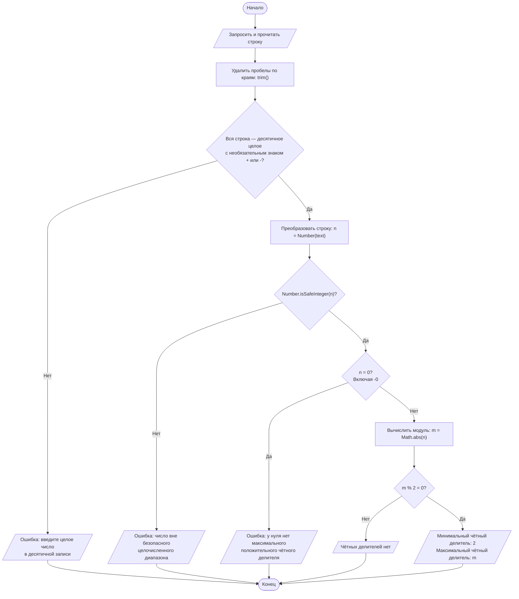

# Блок-схема основного алгоритма

Схема соответствует функции [calculateEvenDivisors](../src/lib/even-divisors.ts). Ищем положительные чётные делители; для отрицательного числа рассматриваем его модуль.

