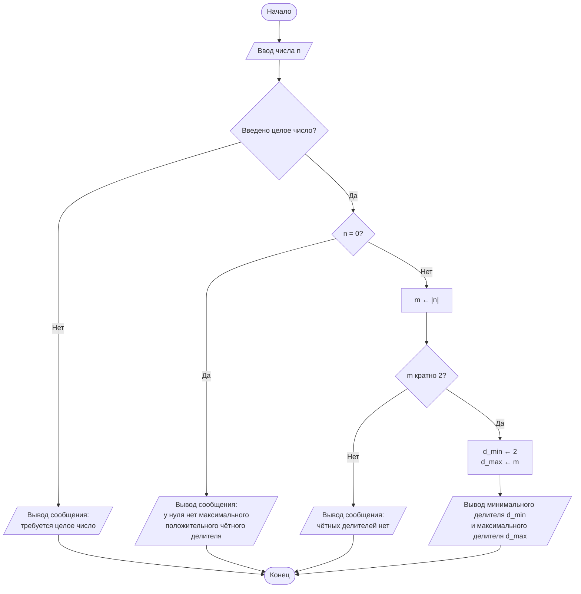

# Блок-схема основного алгоритма

Ищем положительные чётные делители введённого целого числа. Обозначения: `n` — введённое число, `m` — его модуль, `d_min` и `d_max` — минимальный и максимальный чётные делители.

